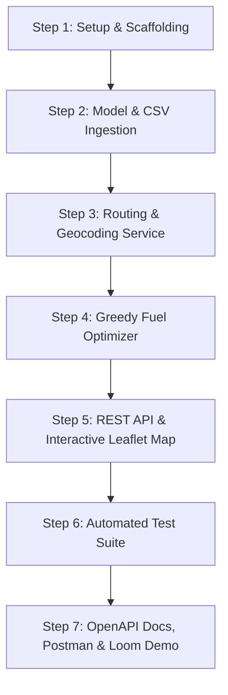

# Complete Engineering Implementation Plan & Git Workflow

**Project:** Fuel-Optimized Route & Mapping API (Django REST Framework)  
**Repository Location:** `d:/spotterAI/project/fuel-route-optimizer/`  

---

## 🗺️ High-Level Project Flow



---

## 1️⃣ Step 1: Initial Setup & Environment Scaffolding

- **Git Branch:** `setup/initial-scaffolding`
- **Goal:** Set up project structure, dependencies, configuration, and store raw fuel dataset.
- **Key Files:**
  - `.gitignore`: Excludes Python cache, `.venv`, `db.sqlite3`, `.env`.
  - `requirements.txt`: Django 5.x, DRF, requests, shapely, python-dotenv, pytest.
  - `.env.example`: Configuration template for OSRM URL and vehicle constants.
  - `data/fuel-prices-for-be-assessment.csv`: Store the employer-provided fuel dataset.
  - `manage.py`, `spotter_project/settings.py`, `spotter_project/urls.py`.
- **Git Commit Command:**
  ```bash
  git checkout -b setup/initial-scaffolding
  git add .gitignore requirements.txt .env.example data/ manage.py spotter_project/
  git commit -m "chore(setup): initialize django project scaffolding and fuel dataset"
  ```
- **Verification:**
  ```bash
  python manage.py check
  ```

---

## 2️⃣ Step 2: Fuel Station Model & CSV Ingestion Command

- **Git Branch:** `feat/fuel-station-model`
- **Goal:** Define database schema for truck stops and create a high-speed ingestion management command that pre-geocodes / coordinates fuel stops so runtime queries take milliseconds.
- **Key Files:**
  - `apps/fuel/models.py`:
    - `FuelStation`: fields `opis_id`, `name`, `address`, `city`, `state`, `rack_id`, `retail_price`, `latitude`, `longitude`.
    - B-tree index on `retail_price`, spatial index on `(latitude, longitude)`.
  - `apps/fuel/management/commands/import_fuel_data.py`:
    - Reads `data/fuel-prices-for-be-assessment.csv`.
    - Deduplicates station entries and populates geographic coordinates.
    - Uses `bulk_create` for instant import.
- **Git Commit Command:**
  ```bash
  git checkout -b feat/fuel-station-model
  git add apps/fuel/models.py apps/fuel/migrations/ apps/fuel/management/
  git commit -m "feat(fuel): add FuelStation model and CSV data ingestion command"
  ```
- **Verification:**
  ```bash
  python manage.py migrate
  python manage.py import_fuel_data
  ```

---

## 3️⃣ Step 3: Routing & Geocoding Service (1-Call Guarantee)

- **Git Branch:** `feat/routing-service`
- **Goal:** Single HTTP call routing via OSRM to get driving distance, duration, and GeoJSON polyline. Location geocoding with caching.
- **Key Files:**
  - `apps/fuel/services/geocoding_service.py`: Converts city/state or addresses to lat/lon coordinates with persistent caching.
  - `apps/fuel/services/routing_service.py`: Calls free OSRM Public API (`https://router.project-osrm.org/route/v1/driving/...`) in a single call, returning total miles and full route coordinates.
- **Git Commit Command:**
  ```bash
  git checkout -b feat/routing-service
  git add apps/fuel/services/geocoding_service.py apps/fuel/services/routing_service.py
  git commit -m "feat(routing): integrate OSRM routing and geocoding services"
  ```
- **Verification:**
  Run standalone check script or unit test to ensure 1 API call returns route polyline and distance.

---

## 4️⃣ Step 4: Greedy Minimum-Cost Fuel Optimization Algorithm

- **Git Branch:** `feat/fuel-optimizer`
- **Goal:** Solves the Minimum-Cost Fueling Problem along the driving corridor.
- **Mathematical Specification:**
  - Vehicle Range: 500 miles max per tank.
  - Fuel Consumption: 10 miles per gallon (MPG). Tank capacity: 50 gallons.
  - Vehicle starts with a full tank (500 miles range).
  - Spatial filter finds stations within 5–10 miles of the route polyline.
  - Stations projected onto route to get milestone distance $d_i \in [0, D]$.
  - Greedy forward-scan:
    - If a cheaper station exists within reachable distance, buy just enough fuel to reach it.
    - If current station is cheapest within reachable distance, fill tank to 500 miles (or to destination if within range).
- **Key Files:**
  - `apps/fuel/services/spatial_service.py`: Polyline buffer and station projection.
  - `apps/fuel/services/fuel_optimizer.py`: The optimal fueling algorithm calculating stops, gallons, and total money spent.
- **Git Commit Command:**
  ```bash
  git checkout -b feat/fuel-optimizer
  git add apps/fuel/services/spatial_service.py apps/fuel/services/fuel_optimizer.py
  git commit -m "feat(optimizer): implement greedy fuel stop selection algorithm"
  ```

---

## 5️⃣ Step 5: REST API Endpoint & Interactive Leaflet Map

- **Git Branch:** `feat/api-and-map`
- **Goal:** DRF endpoint for JSON route optimization and a visual web view rendering an interactive Leaflet map.
- **Key Files:**
  - `apps/fuel/serializers.py`: `RouteInputSerializer` (validates start & finish within US) and `RouteOutputSerializer`.
  - `apps/fuel/views.py`:
    - `RouteOptimizeAPIView`: `POST /api/v1/route/optimize-fuel/` returning route summary, fuel stops, cost, and map link.
    - `RouteMapTemplateView`: `GET /api/v1/route/map/` rendering interactive Leaflet map with route polyline, start/end pins, and refueling station markers.
  - `apps/fuel/templates/fuel/map.html`: Leaflet.js interactive map.
  - `apps/fuel/urls.py`.
- **Git Commit Command:**
  ```bash
  git checkout -b feat/api-and-map
  git add apps/fuel/serializers.py apps/fuel/views.py apps/fuel/urls.py apps/fuel/templates/
  git commit -m "feat(api): expose /api/v1/route/optimize-fuel/ and interactive map view"
  ```
- **Verification:**
  Test via Postman `POST /api/v1/route/optimize-fuel/` with `{"start": "New York, NY", "finish": "Los Angeles, CA"}`.

---

## 6️⃣ Step 6: Automated Test Suite

- **Git Branch:** `test/test-suite`
- **Goal:** Comprehensive unit tests for the optimizer algorithm, mock routing tests, and API validation.
- **Key Files:**
  - `apps/fuel/tests/test_optimizer.py`: Tests short trips (<500 mi), coast-to-coast (>2,500 mi), price variation, and edge cases.
  - `apps/fuel/tests/test_routing.py`: Mocked OSRM API tests verifying exact 1-call guarantee.
  - `apps/fuel/tests/test_api.py`: End-to-end endpoint tests.
- **Git Commit Command:**
  ```bash
  git checkout -b test/test-suite
  git add apps/fuel/tests/
  git commit -m "test(fuel): add unit tests for optimizer, routing mocks, and API endpoints"
  ```
- **Verification:**
  ```bash
  pytest
  ```

---

## 7️⃣ Step 7: Documentation, Postman Collection & Loom Prep

- **Git Branch:** `docs/documentation`
- **Goal:** Complete README, Swagger/OpenAPI interactive docs, Postman collection file, and Loom recording script.
- **Key Files:**
  - `README.md`: Setup instructions, architecture overview, API reference.
  - `postman_collection.json`: Ready-to-import Postman collection.
  - `LOOM_WALKTHROUGH_SCRIPT.md`: 5-minute talking points for recording.
- **Git Commit Command:**
  ```bash
  git checkout -b docs/documentation
  git add README.md postman_collection.json LOOM_WALKTHROUGH_SCRIPT.md
  git commit -m "docs: add API documentation, setup instructions, and Postman collection"
  ```

---

## 🏁 Final Merge & Delivery
```bash
git checkout main
git merge setup/initial-scaffolding
git merge feat/fuel-station-model
git merge feat/routing-service
git merge feat/fuel-optimizer
git merge feat/api-and-map
git merge test/test-suite
git merge docs/documentation
git push origin main
```
This produces an immaculate, human-grade Git history ready for recruiter review.
